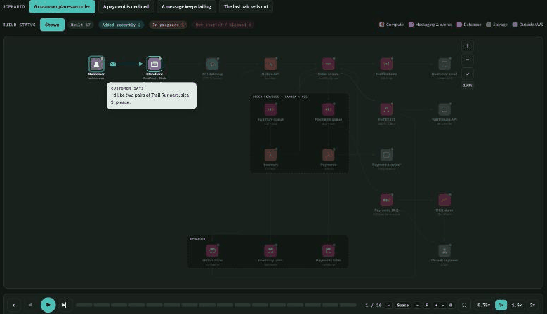
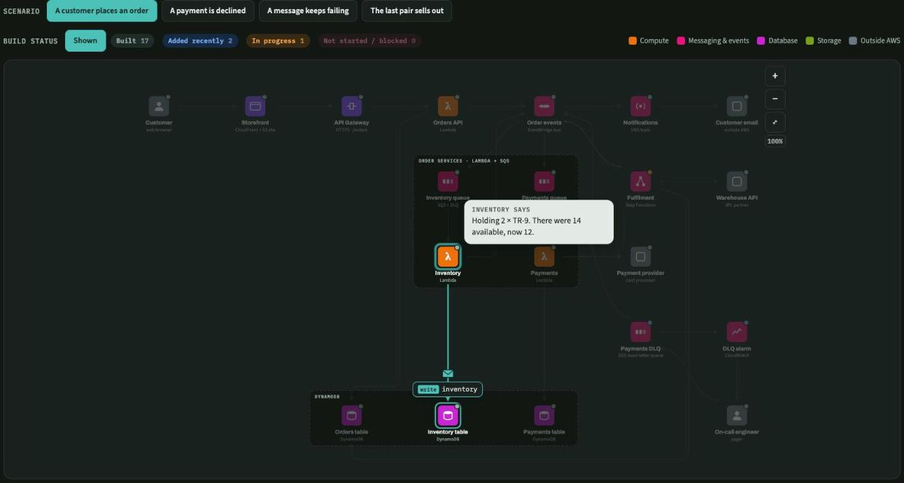
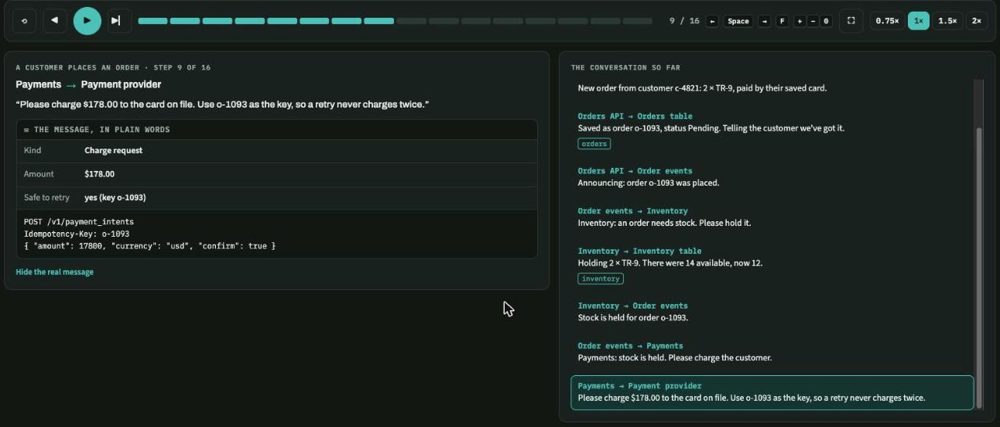
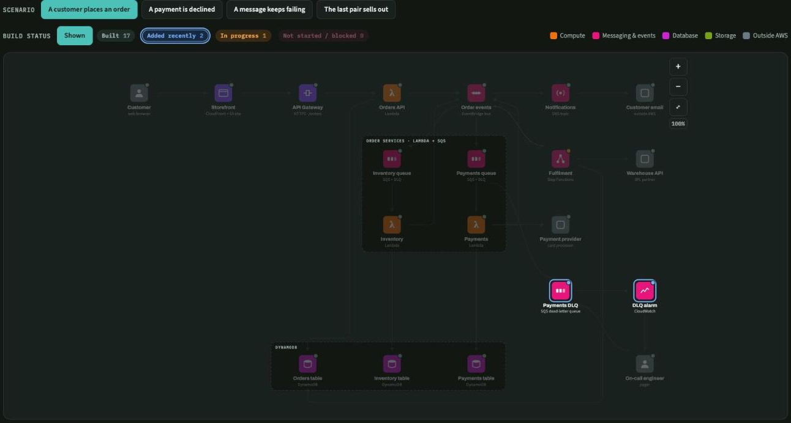
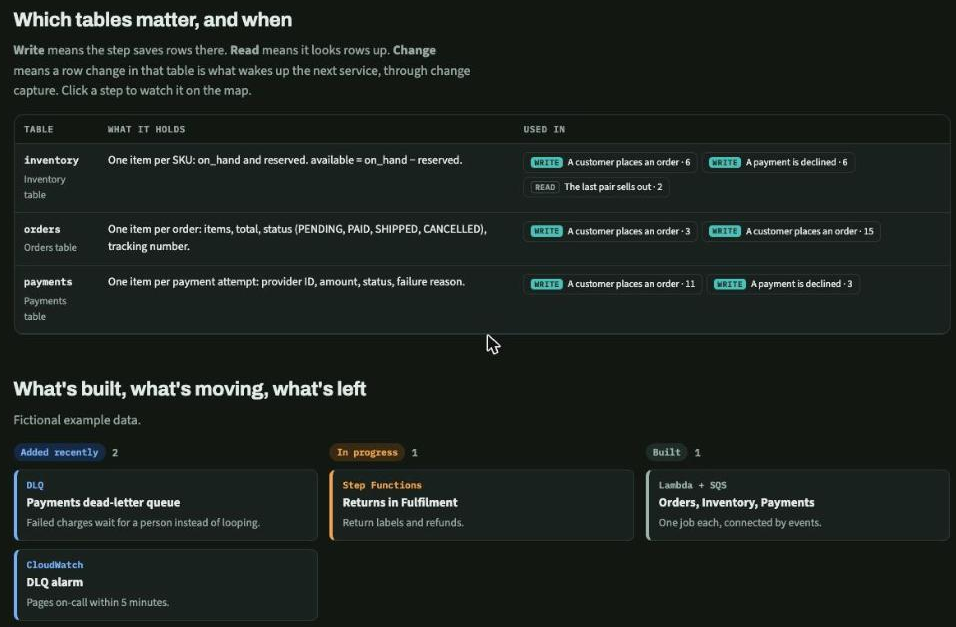

# Ride the system

A [Claude Code](https://claude.com/claude-code) skill that turns a real codebase into an **interactive, video-like walkthrough of its architecture**. Services sit on an AWS-style map, and each scenario plays step by step. You see who asks whom, what they want in plain language, the real message underneath, and which database tables each step reads, writes or triggers on.



**[Open the live demo →](https://shradayshakya.github.io/ride-the-system/)** (a fictional online store; every name in it is made up)

## Why

Architecture diagrams show boxes and arrows, but rarely *what actually happens*. This page answers the questions people really ask:

- **Who calls whom, and why?** Each step is a speech bubble from the sender, in plain words: *"Payments: stock is held. Please charge the customer."*
- **What's in the message?** A plain-language card ("Kind: Charge request · Amount: $178.00 · Safe to retry: yes"), plus **Show the real message** for the exact payload.
- **Which table matters when?** Every step tags the tables it **writes**, **reads**, or **changes** (a change that wakes the next service up). A table index lists every place each table is used.
- **What's built and what's left?** Colour-coded build status. Click a status to highlight those components.

## What it looks like

| | |
|---|---|
|  |  |
| **The map.** AWS-style service tiles. An envelope travels each arrow, and table tags appear on the database being touched. | **The narration.** The step in plain words, the message card, the real payload, and a running conversation log. |
|  |  |
| **Build status.** Click "Added recently" (or any status) to light up just those components. | **Table index.** What each table holds and every step that uses it. Click a step to jump there. |

### Controls

| Action | How |
|---|---|
| Play / pause | ▶ or **Space** |
| Step back / forward | ◀ ▶ or **←** **→** |
| Speed | 0.75× · 1× · 1.5× · 2× |
| Full screen | ⛶ or **F** (Esc to exit). The map takes most of the screen. |
| Zoom | **+** / **−** / **0**, or pinch / Ctrl-scroll (40%–400%). Drag to pan. While zoomed in, the view follows the action. |
| Details | Click any service. Click a build-status chip to filter. |

## Install

The repo *is* the skill. Clone it into your Claude Code skills folder:

```bash
git clone https://github.com/shradayshakya/ride-the-system.git ~/.claude/skills/ride-the-system
```

Then, in any project:

```
/ride-the-system the order pipeline in this repo
```

or just ask *"visualize how this system works end to end"*.

Claude surveys the code and infrastructure (Terraform, CDK, handlers, message schemas), writes a small data file describing the services, arrows, tables and 3–6 real scenarios, checks it, builds the page, and publishes it as an artifact.

## How it works

```
template.html                  the engine: map, player, narration, zoom, full screen, filters, table index
examples/online-store.data.js  a fictional example. Copy its shape
build.py                       data file + template → one self-contained HTML page (--standalone for hosting)
scripts/check.sh               builds every example and checks every node/edge/table reference
SKILL.md                       the instructions Claude follows
```

A data file is plain JavaScript (`window.RIDE = { nodes, edges, groups, tables, scenarios, board }`). The template is never edited per system. Build a page yourself:

```bash
python3 build.py examples/online-store.data.js out.html --standalone
open out.html
```

Keep real, private systems in `examples/local/`. That folder is git-ignored, so internal names never get pushed.

## Requirements

- Python 3 (build), Node.js (checks)
- No runtime dependencies: the page is a single HTML file with inline JS/CSS, using Google Fonts with system fallbacks.

## License

MIT
